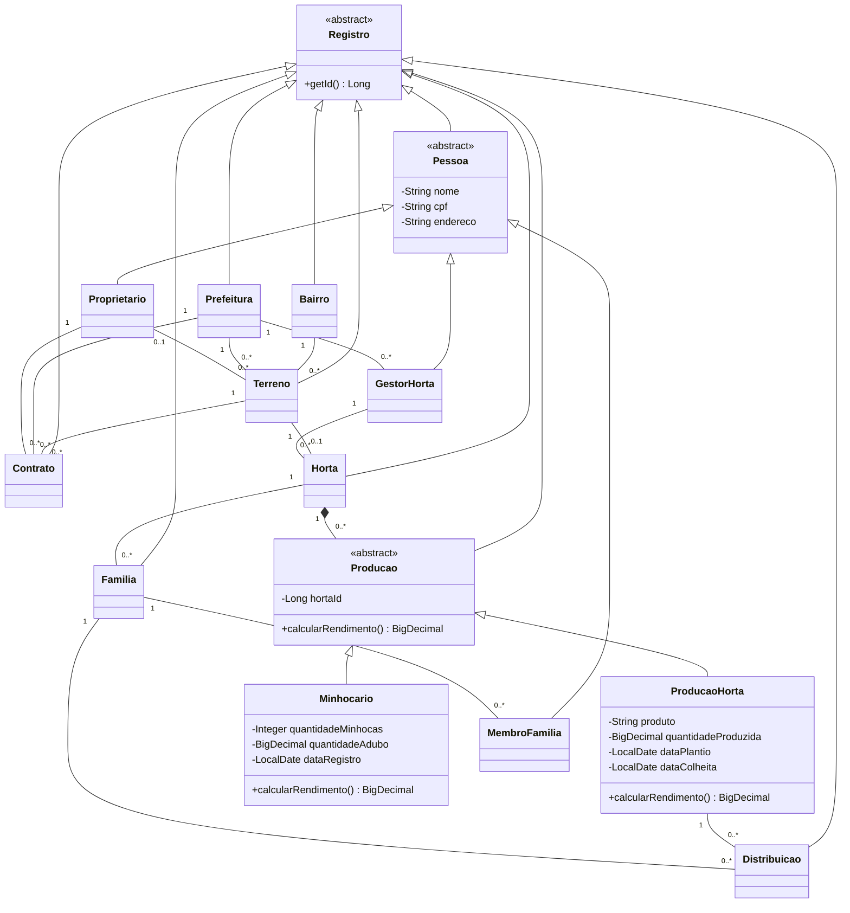
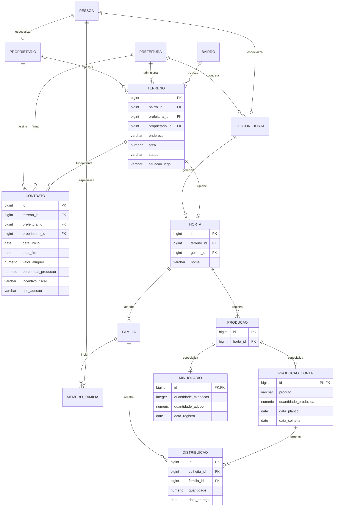

# Modelo da implementação

Os diagramas representam o código e o esquema PostgreSQL da segunda entrega. Os diagramas originais e o relatório de planejamento estão em [diagramas](diagramas) e [detalhesProjeto](detalhesProjeto).

## Classes

## Banco de dados

As referências de prefeitura e proprietário em `contrato` são garantidas pela chave estrangeira composta para `terreno`. A definição de todas as colunas e restrições está no [script SQL](../database/schema.sql).
